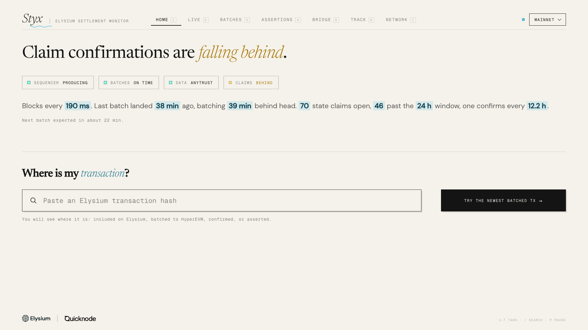
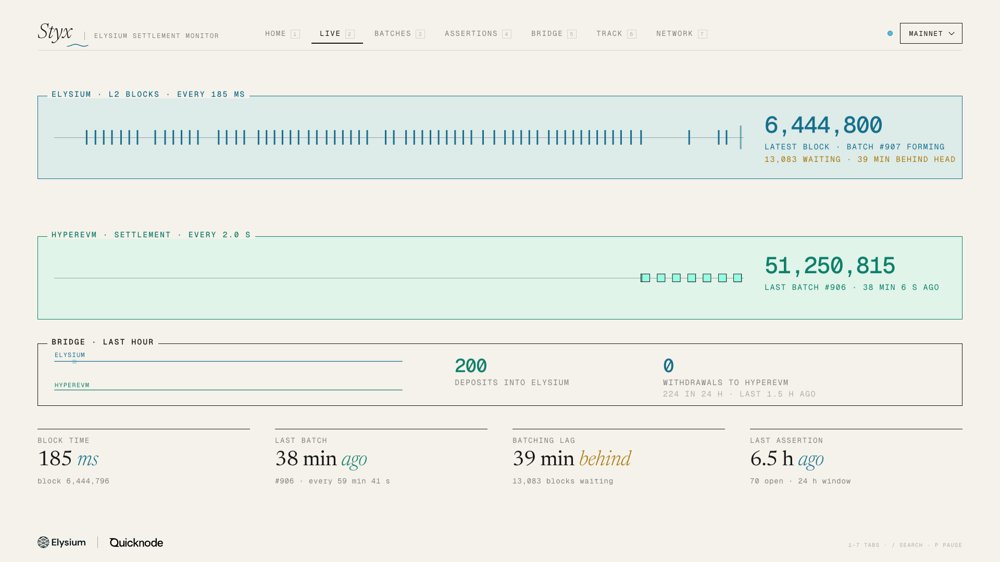
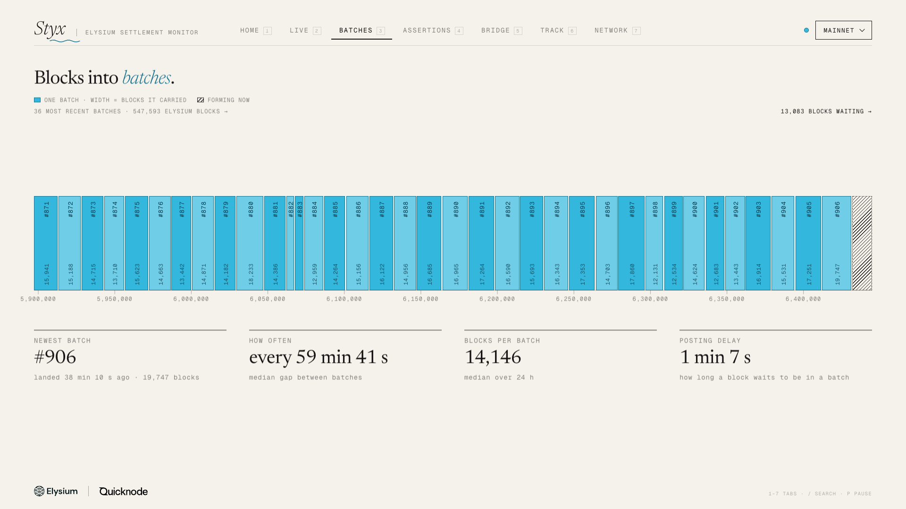
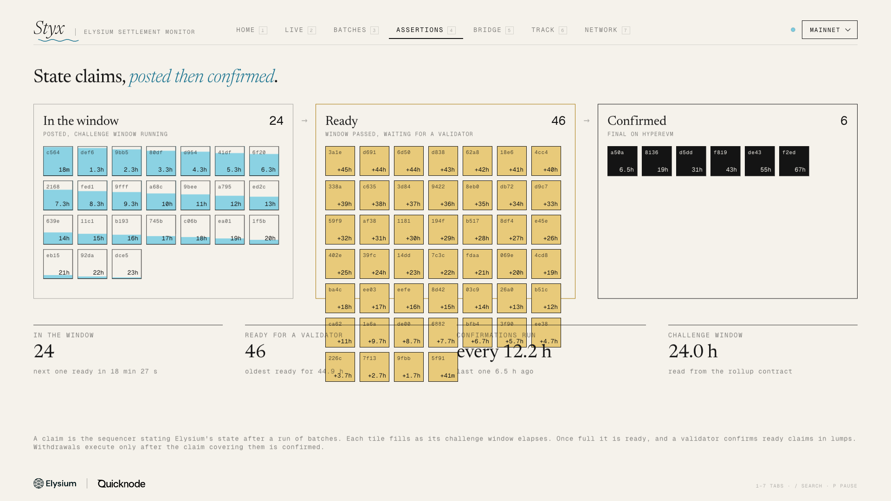
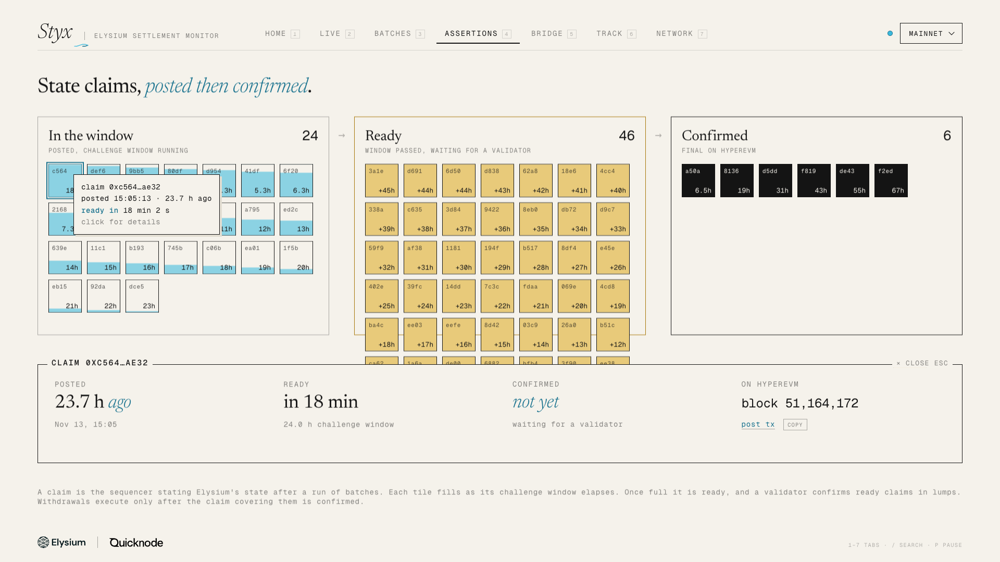
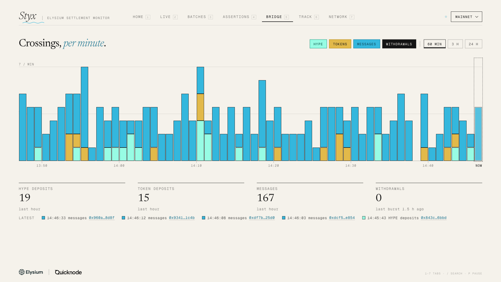
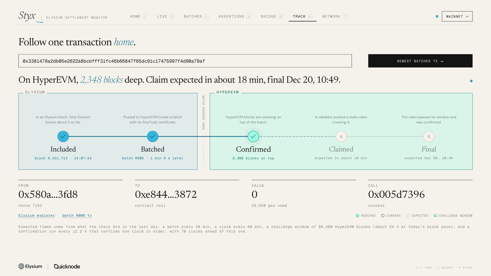
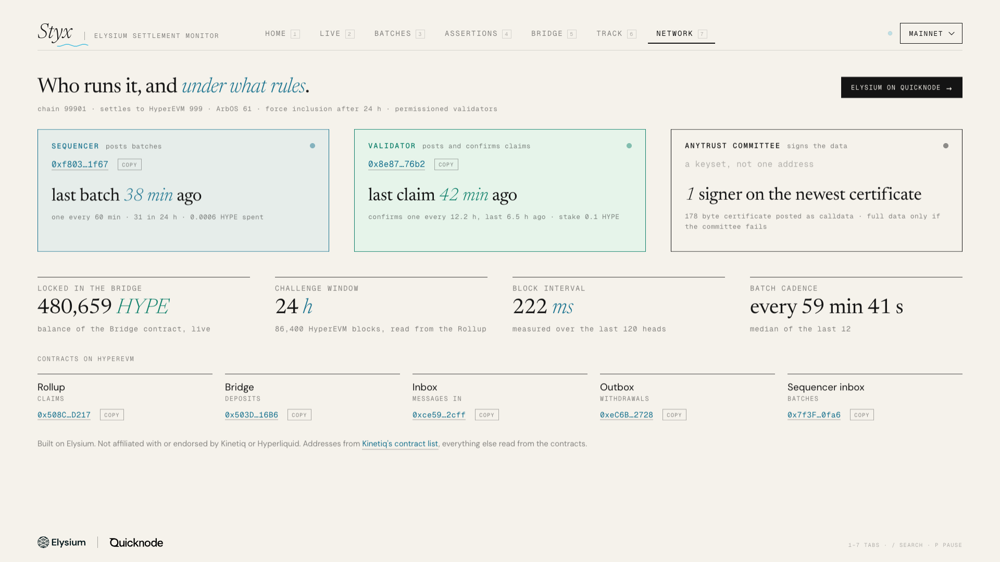

# Styx

Elysium Settlement Monitor. A live picture of how Elysium, the Arbitrum Orbit L2 on Hyperliquid, settles to HyperEVM. Every number on screen is read from the rollup contracts on HyperEVM or from the Elysium node itself. There is no seeded data and no assumed cadence anywhere in it. If the chain has not told us something yet, the page says so.

Styx is the river you cross to reach Elysium. The app watches the crossing.



## What it answers

- Is Elysium settling right now, and if not, which part is late?
- Where is my transaction on its way to finality, and when does it get there?
- How are blocks grouped into batches, and how often do batches land?
- Which state claims are waiting, which are ready, which are confirmed?
- What crosses the bridge, in which direction, and in what volume?
- Who runs the rollup, and under what rules?

## Running it

You need Node 22 and two Quicknode endpoints per network: one for Elysium (HTTP and WebSocket) and one for HyperEVM (HTTP). The Elysium endpoint must support the Arbitrum `arb_*` methods, which Quicknode's do.

```sh
cp .env.example .env   # paste your Quicknode endpoints
npm install
npm run dev            # API on :8787, UI on :5173
```

`NETWORKS=mainnet,testnet` runs a collector per network. The UI switches between them from the dropdown in the header, or with `m` and `t`.

The first start backfills a day or two of history from HyperEVM, which takes about a minute. Until then the snapshot is thin and the live dot stays grey.

## How it is built

Two processes, no database.

The collector (`server/`) is a Node process in TypeScript. It subscribes to Elysium heads over WebSocket, polls the HyperEVM head once a second, fetches rollup logs as new blocks arrive, and keeps everything in memory. Every two seconds it publishes a snapshot. Every event is also pushed the moment it is seen. Both go out over Server Sent Events at `/api/:net/events`.

The UI (`web/`) is Vite, TypeScript and GSAP, no framework. It renders on a fixed 1920 by 1080 stage that scales to the window, so every tab is laid out on the same 12 column grid. Animation runs on one GSAP ticker with transform only motion. We measured it at 59 to 60 fps with no long tasks, and we check for accidental redraws with a mutation observer, because a number that blinks every two seconds for no reason is the fastest way to make a dashboard feel broken.

### API

| Route | What it returns |
|---|---|
| `GET /api/networks` | Which networks are running and whether each has finished backfilling |
| `GET /api/:net/snapshot` | The full state: heads, batches, claims, bridge traffic, health, parameters, operators |
| `GET /api/:net/health` | Just the health block |
| `GET /api/:net/events` | SSE stream: `head`, `l1head`, `batch`, `batch_detail`, `assertion_created`, `assertion_confirmed`, `deposit`, `withdrawal`, `snapshot` |
| `GET /api/:net/tx/0x…` | The settlement ladder for one Elysium transaction |
| `GET /api/:net/sample-tx` | A transaction from the newest batched block, for the demo button |

## Where the data comes from

The collector watches five contracts on HyperEVM. Addresses come from [Kinetiq's contract list](https://elysium.kinetiq.xyz/docs/contract-addresses) and sit in `server/networks.ts`.

| Contract | Event | What we learn |
|---|---|---|
| SequencerInbox | `SequencerBatchDelivered` | A batch landed. The tx calldata tells us which Elysium blocks it holds and how the data was posted |
| Rollup | `AssertionCreated`, `AssertionConfirmed` | A state claim was posted or confirmed (Arbitrum BoLD) |
| Bridge | `MessageDelivered` | A message entered from HyperEVM: kind 12 is a HYPE deposit, kind 9 a retryable ticket (token deposits), kind 3 a plain L2 message |
| Inbox | `InboxMessageDelivered` | Delayed inbox traffic, for the inclusion counters |
| Outbox | `OutBoxTransactionExecuted` | A withdrawal was executed on HyperEVM |

A few values are read with `eth_call` rather than from events: the challenge window (`confirmPeriodBlocks`), the force inclusion delay (`maxTimeVariation`), the delayed message counters on the Bridge and SequencerInbox, the validator's base stake and minimum claim period, whether the validator set is permissioned, the Bridge contract's HYPE balance, and the ArbOS version from the ArbSys precompile on Elysium.

From the Elysium side we take block headers over WebSocket, receipts for tracked transactions, and `arb_findBatchContainingBlock` as a cross check.

### Backfill depth on start

| Data | Depth |
|---|---|
| Batches | 24 h |
| Claims | 48 h |
| Deposits | 24 h |
| Withdrawals | 48 h |

The Elysium chain only gets the heads we see live, plus whatever the batch range calculations need.

## Methodology

A few derivations are worth spelling out, because they are where a monitor like this can quietly go wrong.

Which Elysium blocks a batch holds. The `SequencerBatchDelivered` event does not say. The batch transaction does: its arguments carry `prevMessageCount` and `newMessageCount`, and on a Nitro chain message counts map one to one onto block numbers. So a batch covers blocks `[prev, new - 1]`. We verified this against `arb_findBatchContainingBlock` at both ends of several batches before trusting it.

How the data was posted. The first byte of the batch payload is a header. `0x88` (any byte with the high bit set) is an AnyTrust certificate, which is what Elysium posts in normal operation: 178 bytes instead of the full batch. `0x50` would be blob data. `0x00`, `0x01`, `0x20` or `0x40` mean the full data went on chain, which only happens if the committee fails. The certificate also carries an 8 byte signers mask, and we count its bits to show how many committee members signed.

Cadences. Nothing about timing is hard coded. Batch cadence is the median gap between the last batches, claim cadence the median gap between claims, and the confirmation cadence the median gap between confirmation runs (events closer than ten minutes apart count as one run). The challenge window is `confirmPeriodBlocks` times the measured HyperEVM block time, which is about 0.98 s rather than exactly 1.

Health. Four lights, each with a rule you can read in its tooltip.

| Light | Live | Pending | Failure |
|---|---|---|---|
| Sequencer | newest Elysium block under 4 s old | under 20 s | older |
| Batches | last batch younger than twice the usual gap | under four times | older |
| Data | AnyTrust certificate on the last batch | full data (committee fallback) | |
| Claims | no open claim older than the window plus 25% | claims past the window, but confirmations still land on cadence ("behind") | nothing confirmed in twice the confirmation cadence ("stalled") |

The "behind" state exists because of something that surprised us on mainnet while building this: the validator posts a claim every hour but confirms one claim per run, about every 12 hours, in order. The queue of open claims grows by roughly 22 a day and confirmations trail creation by more than three days. That is not a stall, and calling it one would be wrong, so the rule separates the two.

Expected times on the Track tab come from the cadences above and from queue position. A transaction's claim will be confirmed on the first run that reaches it, never before its own window closes. On today's mainnet that puts finality weeks out, and the app says so rather than pretending the window is the whole story. The note under the transaction card shows the arithmetic.

## The tabs

### Home


The verdict first: "Elysium is settling normally", or the one thing that is not. Below it a row of four chips, one per health light, each clickable into its tab. A sentence with the current numbers, the next batch estimate, and a search box that takes any Elysium transaction hash straight to Track.

### Live



Two lanes that scroll in real time. The Elysium lane ticks a block every hundred milliseconds or so. The HyperEVM lane ticks about once a second. When a batch lands, a certificate drops from the Elysium lane onto the HyperEVM lane. Markers on the HyperEVM lane show claims posted and confirmed. Below the lanes, a bridge panel shows deposits and withdrawals as they happen and a health strip repeats the four lights. Hover any tick for its block number and time.

### Batches



One shelf. Each segment is a batch and its width is the number of Elysium blocks it carries, so a long segment means the sequencer waited longer before posting. The hatched tail on the right is the run of blocks that have been produced but not yet batched. Batch numbers run vertically along the segments. Click a segment for its posting delay, data mode, certificate size, gas and cost.

### Assertions



A claim is the validator stating Elysium's state after a run of batches. The tab is a queue in three zones. Each tile is one claim. In the first zone the tile fills from the bottom as its challenge window elapses. When the window has passed the tile slides to the second zone and waits for a confirmation run. When the Rollup confirms it, the tile slides to the third. Click a tile for its hash, times and explorer links.



### Bridge



A per minute histogram of bridge traffic over the last hour, three hours or a day. Four kinds stacked: HYPE deposits, token deposits (retryable tickets), plain messages, and withdrawals executed through the outbox. The newest bar is still filling and says so. Withdrawals on mainnet arrive in bursts right after a claim confirms, with hours of nothing in between. Zero this hour is usually the truth.

### Track



Paste a hash, or take the newest batched transaction. The rail has five stations: Included on Elysium, Batched to HyperEVM, Confirmed (HyperEVM blocks stacking on top, counted live), Claimed, and Final. Stations the transaction has reached are filled, the current one pulses, the ones ahead are hollow with an expected time. The challenge window is a bar that fills between Claimed and Final. Below the rail, a card with sender, recipient, value and call, plus explorer links for every hop.

The odd inputs are handled too. Paste a HyperEVM hash and the page tells you that is what it is, with a link to the right explorer. A pending transaction keeps polling every three seconds until it lands. Reverted transactions still settle, so they are still tracked, just marked. If the transaction was a withdrawal, an outbox link appears once it has been executed on HyperEVM.

The hash goes into the URL, so a tracked transaction can be shared as a link.

### Network



Who runs it and under what rules. Three cards: the sequencer (the address that posted the newest batch), the validator (the address that posted the newest claim, and confirms them), and the AnyTrust committee (how many members signed the newest certificate). Then the amount of HYPE locked in the Bridge contract, the challenge window, the block interval and the batch cadence. Then the five contracts with copy buttons. All of it comes from the contracts.

On mainnet today one address both posts and confirms claims, the validator set is permissioned, the stake is 0.1 HYPE, and one committee member signs each certificate.

## Keyboard

`1` to `7` switch tabs. `/` jumps to the search box. `p` pauses every animation. `m` and `t` switch network. `Esc` closes an inspector and clears a selection. `Enter` and `Space` open a focused tile or segment, and arrow keys move between batch segments.

## What we refused to do

No hard coded cadences. Early on the batch interval had a seeded default so the charts looked alive before the first two batches arrived, and the "confirmations stalled" light once came from an assumed 24 h window instead of the contract. Both were wrong in small ways and both are gone. If a value is not known yet the UI says "measuring" or "reading". If a value is estimated, the page says what from. And when the chain does something strange, like the confirmation backlog above, the app describes it instead of smoothing it over. A monitor that looks healthy by default is worse than no monitor.

## Layout of the repo

```
server/
  index.ts       HTTP + SSE server, one collector per network
  collector.ts   log ingest, backfill, health rules, snapshot
  tx.ts          the settlement ladder for one transaction
  networks.ts    chain IDs, contracts, event topics, explorers
  rpc.ts         JSON-RPC client with retries and batching
web/src/
  main.ts        header, tabs, network switch, keyboard
  layout.ts      the shared layout kit: title row, facts strip, inspector
  tabs/          one file per tab
  stage/         the Live tab's lanes, bridge panel and health strip
docs/screenshots/
```

## Credits

Built by Quicknode on Elysium. Not affiliated with or endorsed by Kinetiq or Hyperliquid. Contract addresses from Kinetiq's documentation. Brand assets belong to their owners.
